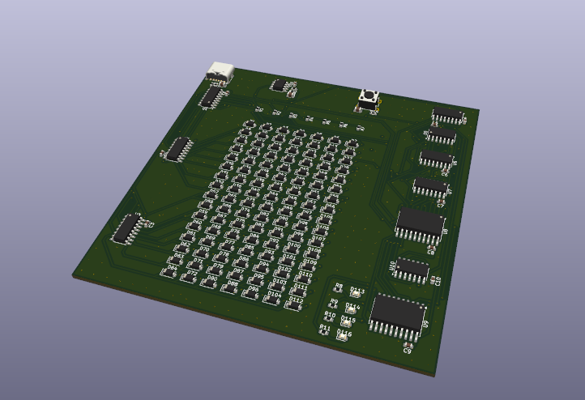
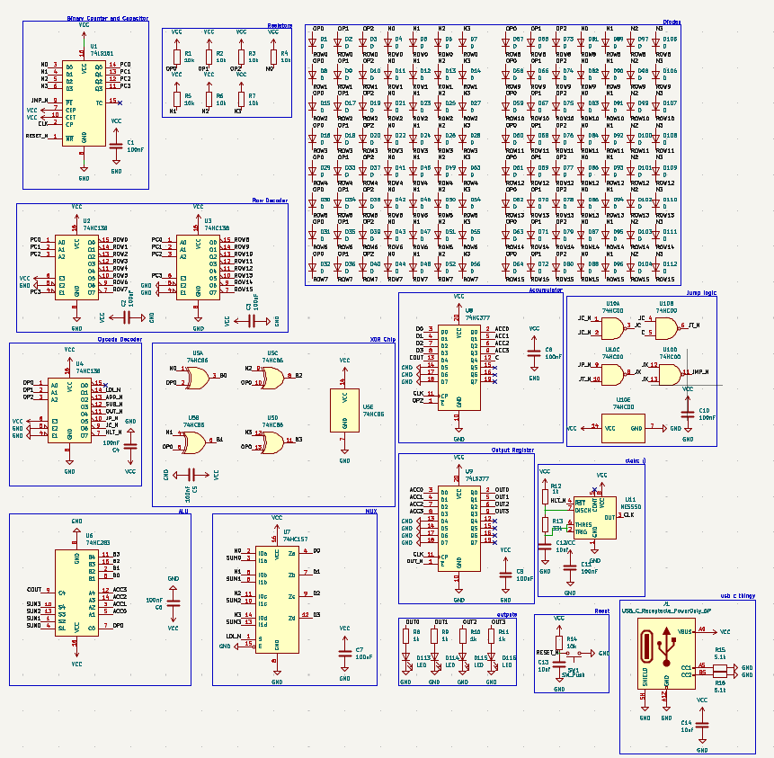
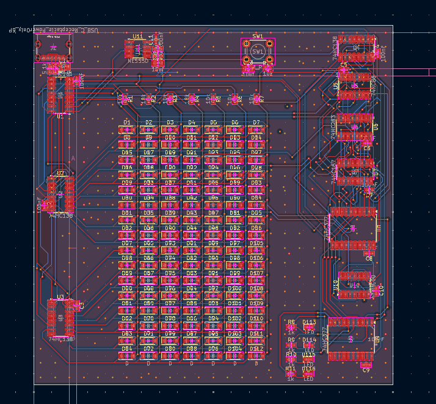

# Nibble

## Overview

Nibble is a tiny 4-bit computer made from nothing but 74HC logic chips. No microcontroller, no Arduino, no EEPROM, just 11 chips and a whole lot of diodes. It's called Nibble because 4 bits is a nibble, and I thought that was funny. :DDD

The fun part is that the program is stored in a grid of 112 diodes, so instead of uploading code you "flash" it with a soldering iron. Yes, really. To change the program you desolder diodes. No, I will not be adding a USB port for programming. :C

This project was built for week 5 of Hack Club's [Half Life YSWS](https://halflife.hackclub.com) program.

## Schematics

Above is the final schematic for Nibble, made in KiCad. It contains a 74HC161 program counter, three 74HC138 decoders, a 74HC86 + 74HC283 ALU, a 74HC157 mux, two 74HC377 registers, a 74HC00 for the jump logic, a 555 timer for the clock, a 16 × 7 diode ROM, 4 LEDs and a USB-C port for power.

The PCB layout is above. yeah idk what else to say, but the right side was basically just a wiry mess.

## Features

- 4-bit CPU made from 11 logic chips
- 8 instructions (listed below)
- 16-step programs stored in diodes (diode = 0, no diode = 1)
- Carry flag, so it can do loops and conditionals (it's basically turing complete if you squint. very hard.)
- 4 LEDs to show the output
- ~2 Hz clock so you can actually watch it think
- Empty ROM rows read as `HLT`, so it can't run off into nothing
- Reset button + auto reset on power up
- USB-C powered

### Instruction set

| Opcode | Instruction | What it does |
|---|---|---|
| `000` | `ADD n` | acc = acc + n (same as 010) |
| `001` | `LDI n` | acc = n |
| `010` | `ADD n` | acc = acc + n, carry flag updates |
| `011` | `SUB n` | acc = acc − n, carry = 1 if there was no borrow |
| `100` | `OUT` | shows acc on the LEDs |
| `101` | `JMP n` | jump to row n |
| `110` | `JC n` | jump to row n, but only if carry = 1 |
| `111` | `HLT` | stops the clock |

Please note that `LDI` also updates the carry flag, so don't use `JC` straight after an `LDI` (it will not do what you want :C)

## Firmware

There is no code. The firmware is literally which diodes you solder. Put a diode wherever you want a 0.

The demo program counts from 0 to 15 on the LEDs and then stops:

| Row | Instruction | Bits | Diodes |
|---|---|---|---|
| 0 | `LDI 0` | `001 0000` | 6 |
| 1 | `OUT` | `100 1111` | 2 |
| 2 | `ADD 1` | `010 0001` | 5 |
| 3 | `JC 5` | `110 0101` | 3 |
| 4 | `JMP 1` | `101 0001` | 4 |
| 5 to 15 | `HLT` | `111 1111` | 0 |

## Hardware & Assembly

Basically, you solder all the chips, resistors, caps, LEDs, the button and the USB-C port like a normal PCB. Then for the ROM, you only solder the diodes that your program needs, all facing the same way (bar towards the row, follow the silkscreen).

Plug it into USB-C, press reset, and watch it count. :33

Some things to note:

- The 5.1k resistors next to the USB-C port are needed or chargers won't give it power.
- If you want a different program, desolder and resolder the diodes. Good luck.

## AI Usage

No AI used in this project.

## Bill of Materials
 
| Item | Purpose | Qty | Price | Source |
|---|---|---|---|---|
| Custom PCB 100×100mm, 2-layer (incl. US$7.60 shipping) | Main board | 5 | US$11.60 | [JLCPCB](https://jlcpcb.com) |
| TI SN74HC161DR SOIC-16 | Program counter | 5 (1 needed) | US$2.56 | [LCSC](https://www.lcsc.com/product-detail/C6824.html?s_z=n_q_C6824&globalKeyword=C6824) |
| Nexperia 74HC138D SOIC-16 | Row decoders + opcode decoder | 5 (3 needed) | US$1.00 | [LCSC](https://www.lcsc.com/product-detail/C5602.html?s_z=n_q_C5602&globalKeyword=C5602) |
| Nexperia 74HC86D SOIC-14 | XOR (for subtracting) | 5 (1 needed) | US$0.71 | [LCSC](https://www.lcsc.com/product-detail/C5955.html?s_z=n_q_C5955&globalKeyword=C5955) |
| TI CD74HC283M96 SOIC-16 | 4-bit adder | 1 | US$0.75 | [LCSC](https://www.lcsc.com/product-detail/C543032.html?s_z=n_q_C543032&globalKeyword=C543032) |
| Nexperia 74HC157D SOIC-16 | Mux | 5 (1 needed) | US$1.85 | [LCSC](https://www.lcsc.com/product-detail/C5609.html?s_z=n_q_C5609&globalKeyword=C5609) |
| Nexperia 74HC377D SOIC-20W | Accumulator + output register | 5 (2 needed) | US$3.85 | [LCSC](https://www.lcsc.com/product-detail/C5639.html?s_z=n_q_C5639&globalKeyword=C5639) |
| Nexperia 74HC00D SOIC-14 | Jump logic | 5 (1 needed) | US$0.60 | [LCSC](https://www.lcsc.com/product-detail/C5586.html?s_z=n_q_C5586&globalKeyword=C5586) |
| TI NE555DR SOIC-8 | Clock | 5 (1 needed) | US$0.55 | [LCSC](https://www.lcsc.com/product-detail/C7593.html?s_z=n_q_C7593&globalKeyword=C7593) |
| 1N4148W SOD-123 | Diode ROM | 50 (20 needed for the demo) | US$0.60 | [LCSC](https://www.lcsc.com/product-detail/C81598.html?s_z=n_q_C81598&globalKeyword=C81598) |
| KT-0603R red LED 0603 | Output | 1 pack (4 needed) | US$0.77 | [LCSC](https://www.lcsc.com/product-detail/C2286.html?s_z=n_q_C2286&globalKeyword=C2286) |
| 10k 0603 resistor | ROM pull-ups + reset | 100 (8 needed) | US$0.22 | [LCSC](https://www.lcsc.com/product-detail/C25804.html?s_z=n_q_C25804&globalKeyword=C25804) |
| 1k 0603 resistor | LEDs + clock | 100 (5 needed) | US$0.17 | [LCSC](https://www.lcsc.com/product-detail/C21190.html?s_z=n_q_C21190&globalKeyword=C21190) |
| 33k 0603 resistor | Clock | 100 (1 needed) | US$0.21 | [LCSC](https://www.lcsc.com/product-detail/C4216.html?s_z=n_q_C4216&globalKeyword=C4216) |
| 5.1k 0603 resistor | USB-C CC | 100 (2 needed) | US$0.16 | [LCSC](https://www.lcsc.com/product-detail/C23186.html?s_z=n_q_C23186&globalKeyword=C23186) |
| 100nF 0603 capacitor | Decoupling (1 per chip) | 1 pack (11 needed) | US$0.72 | [LCSC](https://www.lcsc.com/product-detail/C1591.html?s_z=n_q_C1591&globalKeyword=C1591) |
| 10uF 0805 capacitor | Clock, power-on reset, bulk | 1 pack (3 needed) | US$0.72 | [LCSC](https://www.lcsc.com/product-detail/C15850.html?s_z=n_q_C15850&globalKeyword=C15850) |
| SHOU HAN TS665CJ 6×6mm THT tactile switch | Reset | 1 pack (1 needed) | US$0.94 | [LCSC](https://www.lcsc.com/product-detail/C393938.html?s_z=n_q_C393938&globalKeyword=C393938) |
| USB-C 6-pin power-only receptacle | Power | 5 (1 needed) | US$0.22 | [LCSC](https://www.lcsc.com/product-detail/C18357552.html?s_z=n_q_C18357552&globalKeyword=C18357552) |
| **Total** | | | **US$28.20 + LCSC shipping** | |